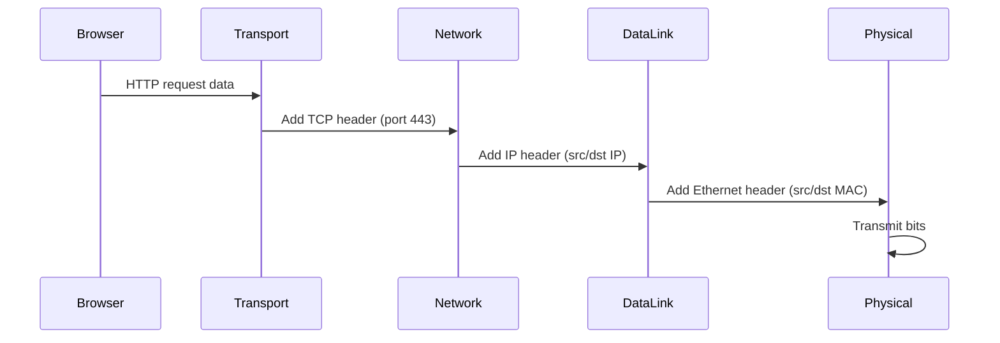

# Module 02 — OSI and TCP/IP Models

## Learning Objectives

- Name and describe all seven OSI layers
- Explain the TCP/IP model layers
- Compare OSI and TCP/IP
- Explain encapsulation and decapsulation
- Understand PDU terminology
- Trace a packet's journey from browser to server

---

## Why Do We Need Models?

Networks involve dozens of different technologies from different manufacturers. Without a common framework, nothing would talk to anything else.

Models solve this by breaking communication into layers. Each layer has a specific job and talks only to the layers directly above and below it.

---

## The OSI Model — Seven Layers

| Layer | Number | Name | PDU | Key Function |
|-------|--------|------|-----|--------------|
| Application | 7 | Application | Data | User-facing protocols (HTTP, DNS, FTP) |
| Presentation | 6 | Presentation | Data | Encryption, compression, encoding |
| Session | 5 | Session | Data | Opens, manages, closes sessions |
| Transport | 4 | Transport | Segment | Reliable delivery, ports (TCP/UDP) |
| Network | 3 | Network | Packet | IP addressing, routing |
| Data Link | 2 | Data Link | Frame | MAC addressing, Ethernet |
| Physical | 1 | Physical | Bits | Electrical signals, cables, Wi-Fi |

**Memory tip:** "All People Seem To Need Data Processing" (top to bottom, 7→1)

---

## The TCP/IP Model

| TCP/IP Layer | OSI Equivalent | Protocols |
|--------------|---------------|-----------|
| Application | Layers 5, 6, 7 | HTTP, DNS, SMTP, FTP |
| Transport | Layer 4 | TCP, UDP |
| Internet | Layer 3 | IP, ICMP, ARP |
| Network Access | Layers 1, 2 | Ethernet, Wi-Fi |

---

## OSI vs TCP/IP

| OSI | TCP/IP | Note |
|-----|--------|------|
| 7 layers | 4 layers | TCP/IP is what networks actually run |
| Theoretical model | Practical model | OSI is used to understand and troubleshoot |

Both matter. Use OSI to understand and explain. Use TCP/IP to understand real protocols.

---

## Encapsulation and Decapsulation

When data travels from your browser to a server, each layer adds its own header:

```
Application:   [        DATA        ]
Transport:     [TCP header][  DATA  ]
Network:       [IP header][TCP][DATA]
Data Link:     [ETH hdr][IP][TCP][DATA][ETH trailer]
Physical:      101010101010101010101010...
```

On the receiving end, each layer removes its own header as data travels upward. This is decapsulation.

---

## Real-World Packet Journey

You type `https://google.com`:



---

## Cybersecurity Relevance

- Layer 2 attacks: MAC flooding, ARP spoofing
- Layer 3 attacks: IP spoofing, routing attacks
- Layer 4 attacks: TCP SYN flood, port scanning
- Layer 7 attacks: SQL injection, XSS, HTTP exploits
- Understanding layers tells you where in the stack an attack is happening

---

## Quick Revision

1. OSI has 7 layers, TCP/IP has 4
2. Switches = Layer 2, Routers = Layer 3
3. Ports = Layer 4, IP addresses = Layer 3, MAC addresses = Layer 2
4. Encapsulation = adding headers going down; Decapsulation = removing headers going up

---

## Practice Questions

1. At which OSI layer does a router operate?
2. What is the PDU name at Layer 4?
3. Which TCP/IP layer corresponds to OSI layers 5, 6, and 7?
4. What happens to headers during decapsulation?
5. At which layer does TLS encryption occur?
