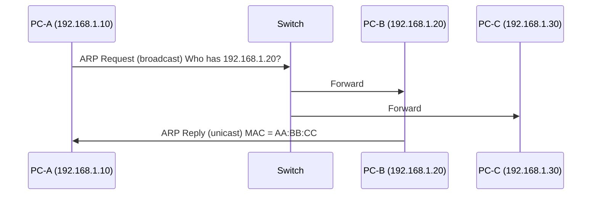

# Module 04 — ARP (Address Resolution Protocol)

## Learning Objectives

- Explain what ARP is and why it exists
- Describe the ARP request and reply process
- Understand what the ARP cache is
- Explain ARP in local vs cross-network communication
- Use `arp -a` and `ip neigh` to inspect the ARP cache
- Understand ARP spoofing at a conceptual level

---

## The Problem ARP Solves

You know the IP address of the device you want to reach — but Ethernet needs a MAC address to deliver the frame.

ARP answers: **"I know your IP address. What is your MAC address?"**

---

## ARP Request and Reply

**Step 1 — ARP Request (broadcast)**

PC-A wants to reach 192.168.1.20 but does not know its MAC address.

PC-A broadcasts to every device on the LAN:
> "Who has IP 192.168.1.20? Tell 192.168.1.10."

Destination MAC = `FF:FF:FF:FF:FF:FF` (everyone receives this)

**Step 2 — ARP Reply (unicast)**

The owner of 192.168.1.20 replies directly to PC-A:
> "I have 192.168.1.20. My MAC is AA:BB:CC:DD:EE:FF."



---

## ARP Cache

After the reply, PC-A saves the mapping in its ARP cache to avoid repeating the process.

```bash
arp -a       # Linux and Windows
ip neigh     # Linux
```

Example output:
```
192.168.1.1   08:00:27:aa:bb:cc   eth0
192.168.1.20  00:1a:2b:3c:4d:5e   eth0
```

---

## ARP When Destination Is on Another Network

If PC-A (192.168.1.10/24) wants to reach 8.8.8.8:

- 8.8.8.8 is not on the local /24 network
- PC-A cannot ARP for 8.8.8.8 — it is not on the LAN
- PC-A instead ARPs for its **default gateway** (the router)
- The router then forwards the packet toward its destination

This is why the default gateway is essential for reaching anything outside your local network.

---

## ARP Spoofing — Conceptual Introduction

ARP has no authentication. Any device can claim to have any IP address.

An attacker on the same LAN sends fake ARP replies:
> "I have 192.168.1.1 (the router). My MAC is Attacker_MAC."

If accepted, traffic meant for the router goes to the attacker instead — a **man-in-the-middle (MitM)** attack.

Covered in depth in Module 10. For now: ARP has no built-in security.

---

## Cybersecurity Relevance

- ARP spoofing enables MitM attacks
- Tools like `arpspoof` and Ettercap exploit this
- Defensive measures: Dynamic ARP Inspection (DAI) on managed switches

---

## Quick Revision

1. ARP = resolves IP address to MAC address
2. ARP Request = broadcast (everyone hears it)
3. ARP Reply = unicast (only requester hears it)
4. ARP Cache = stores recent IP-to-MAC mappings
5. For cross-network traffic: ARP for the default gateway, not the final destination
6. ARP has no authentication → vulnerable to spoofing

---

## Practice Questions

1. PC-A (192.168.1.5) sends an ARP request. What is the destination MAC?
2. After a successful ARP exchange, where is the mapping stored?
3. PC-A (192.168.1.5/24) wants to reach 10.0.0.1. What IP does PC-A ARP for?
4. What command shows the ARP cache on Linux?
5. Why is ARP spoofing possible?
